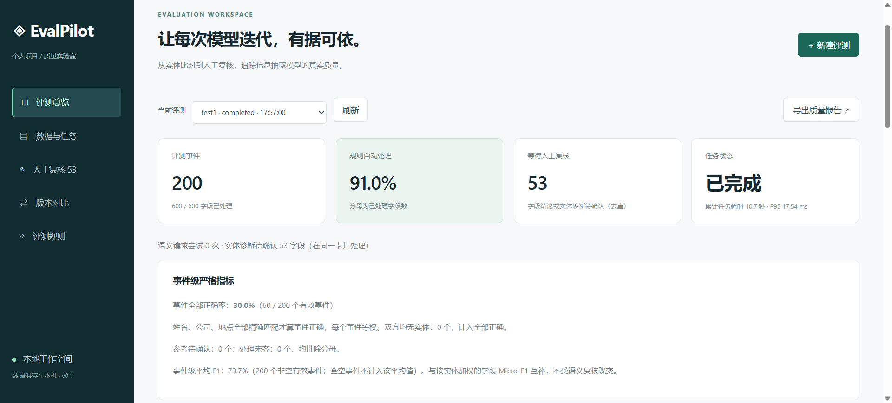
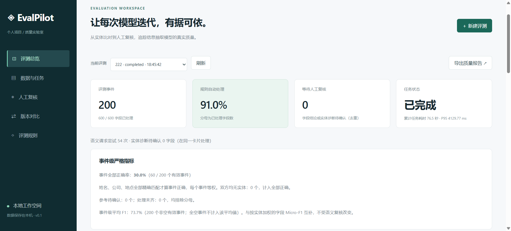

# EvalPilot

**LLM Evaluation Workbench for Information Extraction**

English | [中文](README.md)

EvalPilot helps AI product teams compare extraction model versions, investigate errors, and prioritize human review through a combination of deterministic rules, LLM-assisted diagnosis, and manual review.

It evaluates existing person, company, and location predictions against reference annotations. It does not train or run the extraction model itself.

## Results at a glance

In one comparison on **200 synthetic events / 600 fields**, rules resolved 546 fields. With LLM assistance enabled, all 54 remaining fields received diagnoses that passed the application's validation checks, reducing pending review from **54 to 0**. Strict metrics remained unchanged.

| Item | No LLM | With LLM (non-thinking) |
| --- | --- | --- |
| Fields processed | 600/600 | 600/600 |
| Rule-based decisions | 546 | 546 |
| Auto-validated LLM decisions | 0 | 54 |
| Fields pending review | 54 | 0 |
| Human-confirmed fields | 0 | 0 |
| Person strict F1 | 76.15% | 76.15% |
| Company strict F1 | 86.74% | 86.74% |
| Location strict F1 | 75.62% | 75.62% |
| Event exact-match rate | 30.00% | 30.00% |
| Total runtime | 8.96 s | 76.54 s |
| Field P95 latency | 17.26 ms | 4129.77 ms |
| API request attempts | 0 | 54 |

**Passing automated validation is not proof of diagnostic accuracy.** Predictions were deliberately constructed, reference annotations have not been independently reviewed, and no human review time savings were measured. These are single-run observations using the same inputs, not evidence of an improved extraction model. Human spot checks remain necessary.

Reports (Chinese): [No LLM](examples/reports/evalpilot-report-no-llm.md) · [With LLM](examples/reports/evalpilot-report-with-llm.md). Company F1 of 86.74% alongside an event exact-match rate of 30% shows why per-field metrics cannot substitute for complete-event evaluation.

## Demo

[](https://github.com/wd-1-48/evalpilot/releases/download/demo-v1/evalpilot-demo.mp4)

The video demonstrates the workflow **without LLM assistance**. Its historical cover shows 53 pending fields after one manual review; the published baseline above has 54 pending fields before manual intervention.



This later run adds LLM-assisted diagnosis: rules handle 91% of fields, and 54 API requests address the remaining differences. See the [Chinese README](README.md) for annotated screenshots of metrics, execution steps, and sample-level results. The interface and source reports are in Chinese.

## How it works

1. Import existing predictions and references from CSV or a single-sheet XLSX file.
2. Compute reproducible strict TP/FP/FN and F1 scores; resolve deterministic differences with rules.
3. Optionally ask an LLM to diagnose unresolved differences. Validate response structure, entity coverage, source quotations, and semantic consistency.
4. Route unresolved or invalid results to human review, retain review history, and export reports or compare runs.

Diagnoses cover missing entities, extractions of role words as names, character differences, incomplete names or addresses, and entity-type confusion. Character differences alone do not establish an OCR cause. Semantic decisions never rewrite strict counts.

## Quick start

Requires Python 3.11+.

```bash
git clone https://github.com/wd-1-48/evalpilot.git
cd evalpilot
python -m venv .venv
```

Activate the environment using `.\.venv\Scripts\Activate.ps1` in Windows PowerShell, or `source .venv/bin/activate` on macOS/Linux. Then run:

```bash
python -m pip install -r requirements.txt
python -m uvicorn evalpilot.app:app --host 127.0.0.1 --port 8765
```

Open [the workbench](http://127.0.0.1:8765). Use **加载示例并运行** for a built-in demo without an API key. To replay the published dataset, upload [city-calls-200.xlsx](examples/data/city-calls-200.xlsx) under **数据与任务** and enter `city-calls-sim-v2` as the model version.

For LLM assistance, copy `.env.example` to `.env`, set `LLM_BASE_URL`, `LLM_API_KEY`, and `LLM_MODEL`, then restart. Enable **启用外部模型语义评审** when starting a run. Descriptions and entities are sent to the configured provider. The endpoint must support Chat Completions and JSON output. DeepSeek requests explicitly disable thinking mode; the current combined diagnosis flow retains a 4096-token output limit.

Strict metrics can be checked against the provided data. LLM outputs, validation outcomes, and latency may vary between runs. See [dataset and run notes (Chinese)](examples/README.md).

## Scope and implementation

Built with FastAPI, LangGraph, and SQLite. This is a **local, single-user MVP**, with field-level persistence and interrupted-run recovery. It has no multi-user authorization or production task queue. Recovery is implemented by the application rather than native LangGraph checkpointing.

Next steps include independently reviewed references, spot checks of accepted diagnoses, cost and latency reporting, and authorized real-world evaluation. Team collaboration and online asynchronous evaluation are future work.

```bash
python -m pytest -q
python scripts/benchmark.py
python scripts/check_judge_benchmark.py
```

The repository includes synthetic datasets, regression tests, and candidate benchmarks. They do not establish real-world accuracy, cost savings, or RAG gains.
