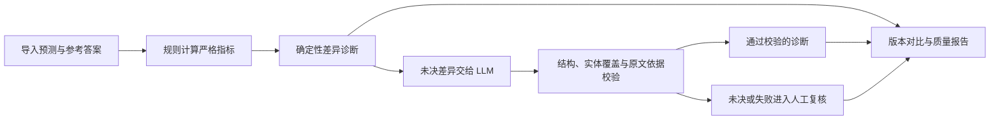

# EvalPilot

**面向信息抽取场景的 LLM 评估工作台**，帮助 AI 产品团队通过“规则 + LLM + 人工复核”比较模型版本、定位 Badcase，把人工注意力集中到仍需判断的案例上。

输入已有的姓名、公司、地点抽取结果与参考答案，输出严格指标、带原文依据的差异诊断、复核队列和质量报告，适用于抽取模型的离线回归与验收。

> **200 条模拟事件、600 个字段的一次运行对比：** 启用 LLM 辅助诊断后，待复核字段从 **54 降至 9（减少 83.3%）**，45 个字段自动通过校验。严格指标保持一致；公司 F1 为 **86.74%**，但事件级全对率仅 **30%**，说明单字段指标不能替代完整事件可用性评估。

减少的是待复核字段数，尚未测量人工工时或验证诊断准确率。预测结果为人为构造，参考答案未经独立人工审核；两次运行使用同一批预测，并非抽取模型升级实验。

[观看 Demo 视频（MP4）](https://github.com/wd-1-48/evalpilot/releases/download/demo-v1/evalpilot-demo.mp4) · [运行对比](#运行对比) · [Badcase 分析](#badcase-分析) · [快速开始](#快速开始) · [200 条模拟数据](examples/data/city-calls-200.xlsx)

## 产品工作流



**产品演示**

[观看或下载 EvalPilot Demo（MP4）](https://github.com/wd-1-48/evalpilot/releases/download/demo-v1/evalpilot-demo.mp4)

| 素材 | 状态 |
| --- | --- |
| 版本对比截图 | 待补充 |
| Badcase 诊断截图 | 待补充 |
| 操作 GIF | 待补充 |
| Demo 视频 | [已提供：evalpilot-demo.mp4](https://github.com/wd-1-48/evalpilot/releases/download/demo-v1/evalpilot-demo.mp4) |

## 运行对比

示例报告：[test-v1（关闭 LLM，规则基线）](examples/reports/evalpilot-report-test-v1.md) ｜ [test-v1.2（LLM 辅助诊断）](examples/reports/evalpilot-report-test-v1.2.md)。

`test-v1` 和 `test-v1.2` 是上传时填写的运行版本标签，不代表抽取模型的不同版本。两次均处理同一批 600 个字段，人工确认均为 0；关闭 LLM 时请求 0 次，开启时请求 54 次，其中 45 个字段的诊断自动通过校验。见[材料说明](examples/README.md)。

| 对比项 | test-v1：关闭 LLM | test-v1.2：LLM 辅助诊断 | 如何解读 |
| --- | --- | --- | --- |
| 处理字段 | 600/600 | 600/600 | 全部字段完成流程；未决项仍需复核 |
| 规则结论 | 546 | 546 | 规则层产出一致 |
| LLM 请求尝试 | 0 | 54 | 仅开启时调用外部模型 |
| 人工确认 | 0 | 0 | 对比不混入人工处理结果 |
| LLM 自动通过校验 | 0 | 45 | 新增自动诊断结论，尚非人工验证正确 |
| 待复核字段 | 54 | 9 | 减少 45/54 = **83.3%** |
| 姓名严格 F1 | 76.15% | 76.15% | 严格指标不随语义改判变化 |
| 公司严格 F1 | 86.74% | 86.74% | 同上 |
| 地点严格 F1 | 75.62% | 75.62% | 同上 |
| 事件全部正确率 | 30.00%（60/200） | 30.00%（60/200） | 三类实体须同时精确匹配 |
| 累计耗时 | 8.96 秒 | 309.17 秒 | 本次开启 LLM 后总耗时约为基线的 **34.5 倍** |
| 字段 P95 | 17.26 毫秒 | 15123.58 毫秒 | 约 0.017 秒 → 15.12 秒 |

这是同一批模拟数据上关闭／开启 LLM 的单次运行对比。耗时受接口、网络和并发影响，34.5 倍不是固定开销；83.3% 是待复核字段数量的减少，不等于实测人工成本节省或模型准确率提升。

## Badcase 分析

从 [LLM 辅助诊断报告](examples/reports/evalpilot-report-test-v1.2.md)可以看到，工作台不仅显示分数，还帮助定位应检查的错误模式。

| 问题 | 报告中的例子 | 诊断来源与产品启示 |
| --- | --- | --- |
| 角色指代误判 | CITY-0003 将「被告」作为姓名；CITY-0007 将「来电人」作为姓名 | 前者由规则确认多识别，后者由 LLM 解释角色指代并识别遗漏的姓名。需要区分角色词与真实姓名实体。 |
| 字符差异 | CITY-0008「澄川市 / 橙川市」；CITY-0035「青岚 / 蓝岚」；CITY-0059「林予安 / 林梓安」 | LLM 诊断通过校验，可定位具体差异字符；不能仅凭错字推断 OCR 原因。 |
| 边界／完整性缺失 | CITY-0005 公司名缺少「有限公司」；CITY-0060 地址缺少「澄川市」 | LLM 将差异归为名称不完整或地点粒度不足。实体抽取既要检查是否识别，也要检查范围是否完整。 |

报告还覆盖「居民」「工作人员」被当成人名等案例。诊断保留原文依据与规则、LLM、人工来源，方便复核人员核对。

## 产品洞察

- **严格指标与语义诊断分离。** TP/FP/FN 和 F1 由代码计算；LLM 或人工改判不会修改原始严格计数，便于复现和追溯。
- **单字段 F1 不能代表完整事件可用性。** 本模拟集公司 F1 为 86.74%，事件级全对率仅 30%；两者口径不同，仅看单字段分数可能高估满足业务要求的事件比例。
- **自动通过校验仍需抽检。** 结构、实体覆盖、原文引用与语义一致性校验能拦截部分问题，无法证明剩余诊断全部正确。此次仍有 9 个字段留在复核队列。
- **辅助诊断更适合离线回归。** 本次运行展示了复核量与等待时间的权衡；在线接入应另行设计异步、抽检与故障降级，不能直接套用离线耗时。

## 快速开始

需要 Python 3.11+：

```bash
git clone https://github.com/wd-1-48/evalpilot.git
cd evalpilot
python -m venv .venv
```

激活虚拟环境：

```powershell
# Windows PowerShell
.\.venv\Scripts\Activate.ps1
```

```bash
# macOS / Linux
source .venv/bin/activate
```

安装并启动：

```bash
python -m pip install -r requirements.txt
python -m uvicorn evalpilot.app:app --host 127.0.0.1 --port 8765
```

打开 [评测工作台](http://127.0.0.1:8765) 或 [API docs](http://127.0.0.1:8765/docs)。Windows 也可运行 `start.ps1`。

### 没有 API Key 也能体验

1. 点击「加载示例并运行」，体验内置模拟数据的导入、指标和复核流程。
2. 要重放本文的 200 条城市投诉样本，在「数据与任务」上传 [city-calls-200.xlsx](examples/data/city-calls-200.xlsx)，模型版本填写 **`city-calls-sim-v2`**。
3. 不勾选外部模型评审，运行后查看严格指标、差异诊断与「人工复核」，再导出报告。

无需真实业务数据即可重放严格指标和评测流程。内置 demo、已有的 [55 条样本](datasets/public_simulation_v1/README.md)与本文 200 条样本是不同数据集，不应混用结果。

### 启用 LLM 辅助诊断

将 `.env.example` 复制为 `.env`，填写 `LLM_BASE_URL`、`LLM_API_KEY`、`LLM_MODEL` 后重启。接口须兼容 Chat Completions 与 JSON 输出；服务进程必须允许访问配置的模型接口。

在同一数据集上新建评测，勾选「启用外部模型语义评审」。相关描述和实体将发送到配置的服务商。缺少配置、连接失败或响应校验不通过时，未决项保留人工复核。

可在「版本对比」比较相同事件、描述与参考答案的评测结果。本文报告是已完成运行的快照，LLM 诊断、待复核量和耗时不保证重跑后逐项相同。原始样本文件的 `model_version` 固定为 `city-calls-sim-v2`，导入时须与之保持一致。

## 实现与验证

FastAPI 提供本地服务，LangGraph 编排严格比较与差异诊断，SQLite 按 `(run_id, event_id, field)` 保存结果。三个字段工作线程并发执行，协调器串行写入。重启后可恢复中断任务，跳过已落库字段；恢复由应用实现，不是 LangGraph 原生检查点。API 响应后、入库前发生崩溃时，仍可能重复调用。

当前评审流程在 `evalpilot/evaluation.py`，旧字段评审与词法检索基线仍保留兼容。未宣称语义向量检索或 RAG 效果提升。详见[流程说明](docs/workflow-v2.md)与[验证记录](docs/verification.md)。

```bash
python -m pytest -q
python scripts/benchmark.py
python scripts/check_judge_benchmark.py
```

测试覆盖导入、指标、语义校验、模拟模型响应、人工复核、版本对比和报告。规则基准是 20 个编写的模拟案例，已有验证记录为 13 个按候选预期解决、7 个保留未决；它是回归集，不是业务准确率证明。配对实验默认离线，`--live` 才会发送外部请求。

## 数据格式与指标口径

支持 CSV / 单工作表 XLSX，标准必填列：

```text
event_id, description,
predicted_person, predicted_company, predicted_location,
reference_person, reference_company, reference_location
```

- 实体列建议保存 JSON 字符串数组；`[]` 表示确认没有实体。可选 `model_version` 必须与导入版本一致。
- 中文矫正表：空白保留该行预测；`未体现`、`未提及`、`无法体现` 表示无实体；其他内容替换预测；`未识别` 保留未决。标准格式空参考表示空集合。
- 严格指标基于规范化实体集合；双方为空不产生 TP，分母为零的 Precision/Recall 为 N/A，参考未知字段不参与严格计分。
- 版本判断变化只比较双方均已有结论的配对字段。标准输入中相同事件的不同描述会被拒绝；矫正表的冲突描述需复核。
- 导入限制为 10 MB / 10,000 行，拒绝宏和公式，并限制 XLSX 解压大小。

## 局限与路线图

当前为**本地单用户 MVP**，使用模拟评测集验证核心流程；尚未基于真实业务数据验证人工成本、诊断准确率或模型质量收益。系统评估已有抽取结果，不训练或运行原始抽取模型。

服务仅绑定 `127.0.0.1`，没有多用户权限、生产任务队列或并发修改控制。密钥、数据库与私有业务数据不进入仓库；公开示例仅包含虚构数据和对应报告。

后续方向（尚未实现）：

- 独立人工审核参考答案，抽检自动通过的诊断，再接入获授权的真实业务数据。
- 团队协作与多任务模板。
- 成本／延迟看板，区分请求失败、校验失败和人工确认。
- 在线异步评估与降级机制。

## 仓库导航

| 路径 | 内容 |
| --- | --- |
| [examples/](examples/README.md) | 本文模拟数据、两份报告及重放说明 |
| `evalpilot/` | API、评测流程、规则、诊断、报告 |
| `static/` | 中文工作台界面 |
| `tests/` | 回归测试 |
| `datasets/` | 其他模拟候选数据与演示集 |
| `benchmarks/` | 候选基准与实验设计 |
| `scripts/` | 验证与配对实验命令 |
| `docs/` | 流程、诊断与验证说明 |
