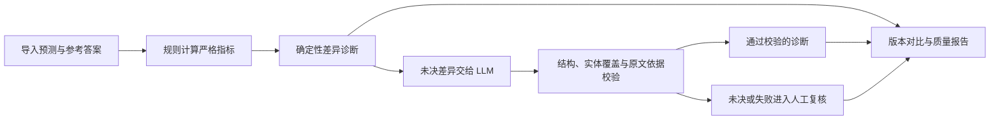
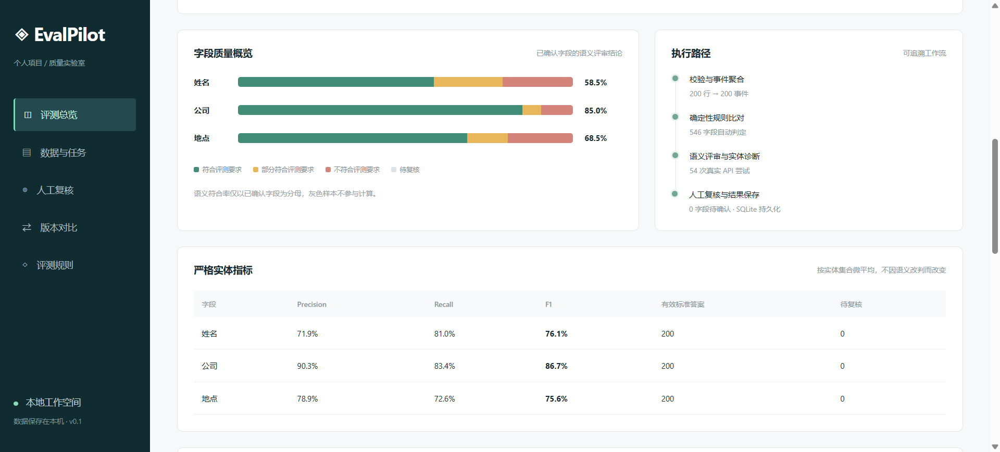
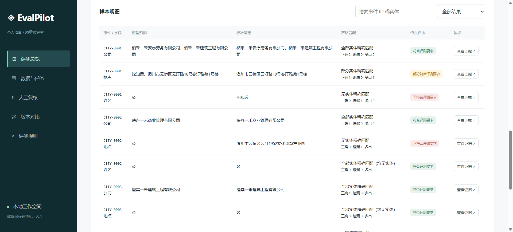
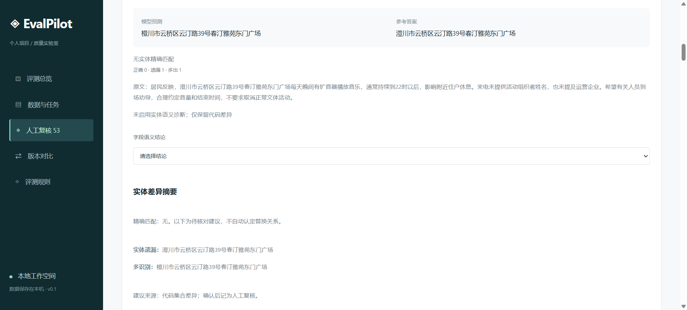

# EvalPilot

**LLM Evaluation Workbench for Information Extraction**

[English](README.en.md) | 中文

**面向信息抽取场景的 LLM 评估工作台**，帮助 AI 产品团队通过“规则 + LLM + 人工复核”发现模型版本退化、定位 Badcase，减少需要逐项人工评估的工作。

输入已有的姓名、公司、地点抽取结果与参考答案，输出严格指标、带原文依据的差异诊断、复核队列和质量报告，适用于抽取模型的离线回归与验收。

> **200 条模拟事件、600 个字段的一次运行对比：** 未启用 LLM 时待复核 54 个字段；启用 LLM 辅助诊断（非思考模式）后，**54 个字段自动通过校验，待复核降至 0**，人工工作可转为抽检。严格指标保持一致；公司 F1 为 **86.74%**，事件全对率仅 **30%**，提示单字段 F1 不能替代完整事件可用性评估。

减少的是待复核字段数，尚未测量人工工时或验证诊断准确率。预测结果为人为构造，参考答案未经独立人工审核；两次运行使用同一批预测，并非抽取模型升级实验。

[观看 Demo 视频（MP4）](https://github.com/wd-1-48/evalpilot/releases/download/demo-v1/evalpilot-demo.mp4) · [运行对比](#运行对比) · [Badcase 分析](#badcase-分析) · [快速开始](#快速开始) · [200 条模拟数据](examples/data/city-calls-200.xlsx)

## 产品工作流



## 🎥 Demo 演示

[](https://github.com/wd-1-48/evalpilot/releases/download/demo-v1/evalpilot-demo.mp4)

**点击封面观看未启用 LLM 的基础流程演示。** 视频展示规则评测与人工复核操作；下方截图补充展示启用 LLM 辅助诊断后的结果。视频托管于本仓库 Releases。

封面来自历史未启用运行，人工处理过 1 个字段，因此显示 53 个待复核；本文正式对照报告使用人工介入前的 54 个字段作为基线。

### 启用 LLM 后：从整体结果到具体样本

**图 1 · 评测总览：规则与 LLM 分工完成 600 个字段评审**


200 条事件对应 600 个字段，规则自动处理 91%（546 个），剩余 54 个字段交由 LLM 辅助诊断。本次运行全部通过现有校验，待复核为 0，总耗时约 76.5 秒。与未启用 LLM 的基线相比，人工可以从逐项处理未决字段转为抽检；这不代表诊断准确率达到 100%。

**图 2 · 指标与执行流程：语义诊断不改写严格指标**



上方条形图展示姓名、公司、地点的语义结论分布，右侧记录 546 个规则判定字段和 54 次模型请求。下方单独展示严格 Precision、Recall、F1，仍与未启用 LLM 时一致。语义符合比例与严格 F1 是不同口径，不能把上方的 58.5%、85.0%、68.5% 当作 F1。

**图 3 · 样本明细：把汇总指标追溯到具体差异**



每个事件按姓名、公司、地点展开，支持并排核对预测和参考答案、查看正确／遗漏／多出数量，并通过“查看证据”继续核查。例如 CITY-0001 的姓名出现在地点预测中，可结合两类字段追踪类型混淆。本图来自启用 LLM 的完整运行，但其中展示的确定性差异可由规则判断，并非每一行都调用了 LLM。

## 运行对比

示例报告（中文）：[未启用 LLM（规则基线）](examples/reports/evalpilot-report-no-llm.md) ｜ [启用 LLM（语义诊断）](examples/reports/evalpilot-report-with-llm.md)。

报告中的 `test-v1` 和 `222` 是运行标签，不代表不同抽取模型。两次处理同一批预测与参考答案，人工确认均为 0；启用运行使用 DeepSeek 非思考模式，单次输出上限为 4096 tokens。详见[样本与运行说明](examples/README.md)。

| 对比项 / Item | 未启用 LLM / No LLM | 启用 LLM / With LLM（非思考模式 / Non-thinking） |
| --- | --- | --- |
| 处理字段 / Fields processed | 600/600 | 600/600 |
| 规则结论 / Rule-based decisions | 546 | 546 |
| LLM 自动通过校验 / Auto-validated LLM decisions | 0 | 54 |
| 待复核字段 / Fields pending review | 54 | 0 |
| 人工确认 / Human-confirmed fields | 0 | 0 |
| 姓名严格 F1 / Person strict F1 | 76.15% | 76.15% |
| 公司严格 F1 / Company strict F1 | 86.74% | 86.74% |
| 地点严格 F1 / Location strict F1 | 75.62% | 75.62% |
| 事件全部正确率 / Event exact-match rate | 30.00%（60/200） | 30.00%（60/200） |
| 新增诊断类型 / Additional diagnosed error types | — | 边界／完整性错误、内容错误 / Boundary, completeness and content errors |
| 累计耗时 / Total runtime | 8.96 s | 76.54 s |
| 字段 P95 / Field P95 latency | 17.26 ms | 4129.77 ms |
| 请求尝试 / API request attempts | 0 | 54 |

本次规则处理 91% 的字段，其余 9% 交由 LLM 辅助诊断。无待复核项表示全部通过现有校验，不代表诊断准确率 100%，仍需抽检。耗时是单次观测，受接口、网络和并发影响；尚未测量实际人工成本节省。

## Badcase 分析

从 [LLM 辅助诊断报告](examples/reports/evalpilot-report-with-llm.md)可以看到，工作台不仅显示分数，还帮助定位应检查的错误模式。

| 问题 | 报告中的例子 | 诊断来源与产品启示 |
| --- | --- | --- |
| 角色指代误判 | CITY-0003 将「被告」作为姓名；CITY-0007 将「来电人」作为姓名 | 前者由规则确认多识别，后者由 LLM 解释角色指代并识别遗漏的姓名。需要区分角色词与真实姓名实体。 |
| 字符差异 | CITY-0008「澄川市 / 橙川市」；CITY-0035「青岚 / 蓝岚」；CITY-0059「林予安 / 林梓安」；CITY-0076「叶明澈 / 叶梓澈」 | LLM 诊断通过校验，可定位具体差异字符；不能仅凭错字推断 OCR 原因。 |
| 类型混淆 | CITY-0036 将营业厅地点放入公司字段；CITY-0014 将公司放入姓名字段；CITY-0001 将姓名放入地点字段 | 通过跨字段比较识别类型错分，避免仅把差异视作孤立的遗漏或多识别。 |
| 边界／完整性缺失 | CITY-0005 公司名缺少「有限公司」；CITY-0060 地址缺少「澄川市」 | LLM 将差异归为名称不完整或地点粒度不足。实体抽取既要检查是否识别，也要检查范围是否完整。 |

报告还覆盖「居民」「工作人员」被当成人名等案例。诊断保留原文依据与规则、LLM、人工来源，方便复核人员核对。

<details>
<summary>查看人工复核界面示例</summary>



这是历史运行的界面截图，显示未启用语义诊断及人工处理后的 53 个待复核字段，仅用于说明复核操作。本文对照实验的基线为 54 个字段，最新启用运行为 0 个；本图不代表 LLM 诊断结果。

</details>

## 产品洞察

- **严格指标与语义诊断分离。** TP/FP/FN 和 F1 由代码计算；LLM 或人工改判不会修改原始严格计数，便于复现和追溯。
- **单字段 F1 不能代表完整事件可用性。** 本模拟集公司 F1 为 86.74%，事件级全对率仅 30%；两者口径不同，仅看单字段分数可能高估满足业务要求的事件比例。
- **自动通过校验仍需抽检。** 结构、实体覆盖、原文引用与语义一致性校验能拦截部分问题，无法证明剩余诊断全部正确。本次无待复核项，仍应抽查自动通过的诊断；人工确认数量为 0。
- **辅助诊断更适合离线回归。** 本次运行展示了复核量与等待时间的权衡；在线接入应另行设计异步、抽检与故障降级，不能直接套用离线耗时。

## 快速开始

需要 Python 3.11+：

```bash
git clone https://github.com/wd-1-48/evalpilot.git
cd evalpilot
python -m venv .venv
```

激活虚拟环境：

```powershell
# Windows PowerShell
.\.venv\Scripts\Activate.ps1
```

```bash
# macOS / Linux
source .venv/bin/activate
```

安装并启动：

```bash
python -m pip install -r requirements.txt
python -m uvicorn evalpilot.app:app --host 127.0.0.1 --port 8765
```

打开 [评测工作台](http://127.0.0.1:8765) 或 [API docs](http://127.0.0.1:8765/docs)。Windows 也可运行 `start.ps1`。

### 没有 API Key 也能体验

1. 点击「加载示例并运行」，体验内置模拟数据的导入、指标和复核流程。
2. 要重放本文的 200 条城市投诉样本，在「数据与任务」上传 [city-calls-200.xlsx](examples/data/city-calls-200.xlsx)，模型版本填写 **`city-calls-sim-v2`**。
3. 不勾选外部模型评审，运行后查看严格指标、差异诊断与「人工复核」，再导出报告。

无需真实业务数据即可重放严格指标和评测流程。内置 demo、已有的 [55 条样本](datasets/public_simulation_v1/README.md)与本文 200 条样本是不同数据集，不应混用结果。

### 启用 LLM 辅助诊断

将 `.env.example` 复制为 `.env`，填写 `LLM_BASE_URL`、`LLM_API_KEY`、`LLM_MODEL` 后重启。接口须兼容 Chat Completions 与 JSON 输出；服务进程必须允许访问配置的模型接口。

在同一数据集上新建评测，勾选「启用外部模型语义评审」。相关描述和实体将发送到配置的服务商。缺少配置、连接失败或响应校验不通过时，未决项保留人工复核。

可在「版本对比」比较相同事件、描述与参考答案的评测结果。本文报告是已完成运行的快照，LLM 诊断、待复核量和耗时不保证重跑后逐项相同。原始样本文件的 `model_version` 固定为 `city-calls-sim-v2`，导入时须与之保持一致。

## 实现与验证

FastAPI 提供本地服务，LangGraph 编排严格比较与差异诊断，SQLite 按 `(run_id, event_id, field)` 保存结果。三个字段工作线程并发执行，协调器串行写入。重启后可恢复中断任务，跳过已落库字段；恢复由应用实现，不是 LangGraph 原生检查点。API 响应后、入库前发生崩溃时，仍可能重复调用。

当前评审流程在 `evalpilot/evaluation.py`，旧字段评审与词法检索基线仍保留兼容。未宣称语义向量检索或 RAG 效果提升。详见[流程说明](docs/workflow-v2.md)与[验证记录](docs/verification.md)。

```bash
python -m pytest -q
python scripts/benchmark.py
python scripts/check_judge_benchmark.py
```

测试覆盖导入、指标、语义校验、模拟模型响应、人工复核、版本对比和报告。规则基准是 20 个编写的模拟案例，已有验证记录为 13 个按候选预期解决、7 个保留未决；它是回归集，不是业务准确率证明。配对实验默认离线，`--live` 才会发送外部请求。

## 数据格式与指标口径

支持 CSV / 单工作表 XLSX，标准必填列：

```text
event_id, description,
predicted_person, predicted_company, predicted_location,
reference_person, reference_company, reference_location
```

- 实体列建议保存 JSON 字符串数组；`[]` 表示确认没有实体。可选 `model_version` 必须与导入版本一致。
- 中文矫正表：空白保留该行预测；`未体现`、`未提及`、`无法体现` 表示无实体；其他内容替换预测；`未识别` 保留未决。标准格式空参考表示空集合。
- 严格指标基于规范化实体集合；双方为空不产生 TP，分母为零的 Precision/Recall 为 N/A，参考未知字段不参与严格计分。
- 版本判断变化只比较双方均已有结论的配对字段。标准输入中相同事件的不同描述会被拒绝；矫正表的冲突描述需复核。
- 导入限制为 10 MB / 10,000 行，拒绝宏和公式，并限制 XLSX 解压大小。

## 局限与路线图

当前为**本地单用户 MVP**，使用模拟评测集验证核心流程；尚未基于真实业务数据验证人工成本、诊断准确率或模型质量收益。系统评估已有抽取结果，不训练或运行原始抽取模型。

服务仅绑定 `127.0.0.1`，没有多用户权限、生产任务队列或并发修改控制。密钥、数据库与私有业务数据不进入仓库；公开示例仅包含虚构数据和对应报告。

后续方向（尚未实现）：

- 独立人工审核参考答案，抽检自动通过的诊断，再接入获授权的真实业务数据。
- 团队协作与多任务模板。
- 成本／延迟看板，区分请求失败、校验失败和人工确认。
- 在线异步评估与降级机制。

## 仓库导航

| 路径 | 内容 |
| --- | --- |
| [examples/](examples/README.md) | 本文模拟数据、两份报告及重放说明 |
| `evalpilot/` | API、评测流程、规则、诊断、报告 |
| `static/` | 中文工作台界面 |
| `tests/` | 回归测试 |
| `datasets/` | 其他模拟候选数据与演示集 |
| `benchmarks/` | 候选基准与实验设计 |
| `scripts/` | 验证与配对实验命令 |
| `docs/` | 流程、诊断与验证说明 |
