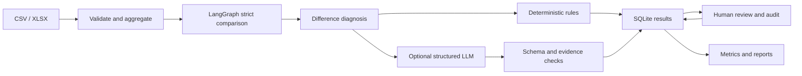

# EvalPilot

An evaluation workbench for information extraction models, built with FastAPI and LangGraph. Supports rule-based comparison, LLM-assisted evaluation, human review, version comparison, and report export.

EvalPilot compares existing person, company, and location predictions against references. It does not train or run the original extraction model. The interface is in Chinese; this is a local, single-user portfolio project.

## Features

- CSV / single-sheet XLSX validation, event aggregation, entity normalization, and Chinese correction-table support.
- Strict entity TP/FP/FN and micro precision/recall/F1, separate from semantic judgments.
- LangGraph strict comparison and difference diagnosis: rules handle one-sided differences; optional LLM calls combine field judgment and entity diagnosis for unresolved two-sided differences.
- Pydantic schemas, allowed labels, entity coverage, verbatim evidence, and semantic consistency checks. Invalid outputs remain pending review.
- Field and entity human review with audit records, preserving original strict counts.
- Version comparison with matching event, description, and reference fingerprints.
- SQLite per-field persistence, interrupted-run recovery, event metrics, and report export.

## Quick start

Python 3.11+:

```bash
git clone https://github.com/wd-1-48/evalpilot.git
cd evalpilot
python -m venv .venv
```

Activate the environment:

```powershell
# Windows PowerShell
.\.venv\Scripts\Activate.ps1
```

```bash
# macOS / Linux
source .venv/bin/activate
```

Install and start:

```bash
python -m pip install -r requirements.txt
python -m uvicorn evalpilot.app:app --host 127.0.0.1 --port 8765
```

Open [the workbench](http://127.0.0.1:8765) or [API docs](http://127.0.0.1:8765/docs). Windows users can also run `start.ps1`.

### Demo without an API key

1. Click **加载示例并运行** to evaluate the built-in synthetic data.
2. Inspect metrics and differences, then open **人工复核** to review pending decisions.
3. Import synthetic v2 from **数据与任务**, run it, and compare v1/v2 in **版本对比**.
4. Export a report to inspect counts and supporting evidence.

Each built-in version has 200 synthetic events. Differences are constructed for demonstration, not measured real-model improvements. A separate [55-event importable CSV](datasets/public_simulation_v1/README.md) is provided.

### Optional LLM configuration

Copy `.env.example` to `.env`, set `LLM_BASE_URL`, `LLM_API_KEY`, and `LLM_MODEL`, then restart. The endpoint must support Chat Completions-compatible JSON responses.

External calls are opt-in per run via **启用外部模型语义评审**. Relevant descriptions and entities are sent to the configured provider. Missing credentials, API failures, or invalid evidence leave unresolved cases pending. The current combined workflow does not use a self-reported confidence threshold. Transient failures have up to three attempts.

## Architecture



Three field workers run concurrently; the coordinator serializes writes. Each completed field is stored under `(run_id, event_id, field)`. Restart marks running tasks interrupted; resume skips committed results. Recovery is application-managed, not LangGraph native checkpointing. A crash after an API response but before its commit can repeat a call.

The legacy field judge and lexical policy-retrieval baseline remain for compatibility. The current worker uses `evalpilot/evaluation.py`; no semantic embedding or RAG improvement is claimed. See [workflow details](docs/workflow-v2.md).

## Data and metrics

Required columns:

```text
event_id, description,
predicted_person, predicted_company, predicted_location,
reference_person, reference_company, reference_location
```

Use JSON arrays for entity cells, especially for entities containing commas. Optional `model_version` must match the uploaded version. Standard-format empty references mean confirmed empty sets.

Chinese correction tables use a separate policy: blank corrections preserve the row prediction; `未体现`, `未提及`, and `无法体现` indicate absence; other text replaces the prediction before aggregation. `未识别` remains unresolved. Conflicting descriptions require review for correction tables and are rejected for standard inputs.

- Strict metrics use normalized entity sets; semantic aliases and reviewed judgment levels do not rewrite strict counts.
- Two empty sets produce no TP. Undefined precision/recall is N/A.
- Unknown references are excluded from strict scoring; pending judgments are reported separately.
- Version judgment changes count pairs confirmed on both sides.
- Imports are limited to 10 MB / 10,000 rows; macros and formulas are rejected and XLSX decompression is bounded.

## Validation

```bash
python -m pytest -q
python scripts/benchmark.py
python scripts/check_judge_benchmark.py
```

The local test suite passed **58 tests**, covering imports, metrics, semantic gates, mocked LLM responses, review validation, audits, comparisons, and reports. See [verification](docs/verification.md).

The rule benchmark contains 20 authored synthetic cases: 13 correctly resolved under authored expectations and 7 abstentions. This is an implementation regression set, not a business accuracy estimate. Candidate datasets have AI-proposed references, not independently adjudicated gold standards. Public results do not establish provider quality or RAG gains. The paired experiment runner defaults to offline mode; `--live` enables external calls.

## Repository map

| Path | Purpose |
| --- | --- |
| `evalpilot/` | API, graph, rules, diagnosis, reporting |
| `static/` | HTML/CSS/JavaScript workbench |
| `tests/` | Regression tests |
| `datasets/` | Public synthetic candidates and demo CSV |
| `benchmarks/` | Candidate sets and experiment designs |
| `scripts/` | Validation and paired experiment commands |
| `docs/` | Workflow, diagnosis, verification notes |

## Scope

Bind to `127.0.0.1`: there is no authentication, production queue, or multi-user conflict control. Credentials, databases, private data, exports, and local experiment runs are excluded from Git. `requirements.lock` records the original environment; quick start and CI use `requirements.txt`.

Next steps: independently reviewed references, controlled provider experiments, and measured latency/cost comparisons. Semantic retrieval and production deployment remain future work.
